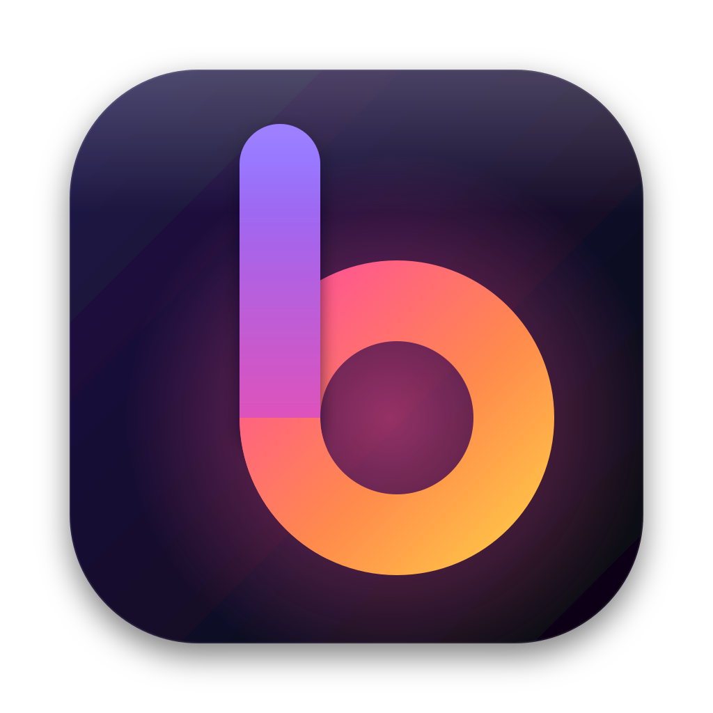

<div align="center">



# Bowvane

**Arc is shutting down on December 22, 2026. Your sidebar doesn't have to.**

An open-source, Chromium-based browser for macOS that keeps Arc's way of working —<br>
and imports your Arc sidebar, extensions included, on first launch.

[](https://github.com/bowvane/bowvane/actions/workflows/ci.yml)
[](LICENSE)


[Features](#features) · [Arc import](#bringing-your-arc-with-you) · [Extensions](#chrome-extensions) · [Install](#install) · [Shortcuts](#keyboard-shortcuts) · [Roadmap](#roadmap) · [Contributing](#contributing)

</div>

---

## Why Bowvane

Arc changed how a lot of us use the web, and now it is going away. The alternatives either ask you to start over or ship a different idea of what a browser is.

Bowvane makes a narrow promise: **keep Arc's workflow alive, in the open, so it can never be switched off again.**

- **No account, no sync server.** Everything lives in a folder on your Mac.
- **No AI you didn't ask for.** The browser does not send your pages anywhere.
- **Your data is portable.** Spaces, tabs and settings are plain JSON you can read, back up and move.

> [!WARNING]
> **Early alpha.** Bowvane is used daily by its author, but expect rough edges. The interface is in French for now; English is the next milestone. Read [Known limitations](#known-limitations) before switching.

## Features

### The sidebar, as you know it

| | |
|---|---|
| **Spaces** | Name, emoji, color and light or dark appearance. Each Space can use its own profile, with separate cookies and logins. Switch with `⌃1`…`⌃9`, `⌥⌘←` / `⌥⌘→`, or a horizontal two-finger swipe on the sidebar. |
| **Favorites** | The grid of app icons at the top, shared by every Space. |
| **Pinned** | Nested folders, drag and drop, rename, and *back to the pinned URL* when a tab has wandered off. |
| **Today** | Unpinned tabs archive themselves after 12 hours of inactivity (configurable); `⇧⌘K` clears Today by hand. Archived tabs stay one click away. |
| **Hidden sidebar** | `⌘S` hides it; move the pointer to the left edge and it slides back over the page. |

### Getting around

| | |
|---|---|
| **Command Bar** | `⌘T` / `⌘L` — one field for open tabs, history, actions, URLs and search. |
| **Little Bowvane** | `⌥⌘N` — a small floating window for quick links, promotable to a full tab. |
| **Air Traffic Control** | Rules that send links from a domain or path to a chosen Space or to Little Bowvane. |
| **Split View** | `⌃⇧=` puts two tabs side by side, `⌃⇧-` closes the pane. |
| **Peek** | Preview an outbound link without leaving the page. |

### Making the web yours

| | |
|---|---|
| **Boosts** | Per-site CSS and JavaScript. |
| **Zap** | Click any element to hide it for good on that site. |
| **Ad and tracker blocking** | Built in, using Ghostery's engine and filter lists. No extension needed. |
| **Little things** | Copy the URL (`⇧⌘C`) or a Markdown link (`⌥⇧⌘C`), capture the page (`⇧⌘2`), find in page (`⌘F`), reopen a closed tab (`⇧⌘T`), automatic Picture-in-Picture, per-tab mute, private windows. |

## Bringing your Arc with you

On first launch, if Arc's data is still on your Mac, Bowvane imports it. You can run the import again any time from **Settings** (`⌘,`).

| What | How |
|---|---|
| **Spaces** | From `StorableSidebar.json`: names, emoji, colors, light and dark themes, and which Arc profile each Space used. |
| **Pinned tabs and folders** | Including nested folders, in their original order. |
| **Favorites** | The top grid, in order. |
| **Favicons** | Reused from Arc's own cache, so the first launch already looks like home. |
| **Extensions** | Every extension enabled in each Arc profile is *copied*, not linked, so it keeps working after Arc is gone. The ones you pinned in Arc's top bar stay pinned. |

Nothing is uploaded and Arc's files are only read, never modified.

> [!NOTE]
> Logins do not come across: macOS encrypts browser cookies with a key tied to each app. Expect to sign in to your sites once.

## Chrome extensions

Extensions sit where Arc puts them: the **puzzle button** in the sidebar's top bar lists them all, and a pin keeps an extension's icon in the bar. Clicking an icon opens its popup.

Bowvane runs on Electron, which implements only part of Chrome's extension APIs. Here is how the extensions its author uses behave today, tested on a real Mac:

| Extension | Status | Notes |
|---|---|---|
| NotebookLM Ultra Exporter | ✅ Works | Popup and page integration. File export depends on the missing `downloads` API. |
| Dashlane | 🟡 Partial | Popup and sign-in open; autofill fails to start. |
| React Developer Tools | 🟡 Partial | Injects into pages, but the popup cannot see the active tab. |
| Cookie-Editor | 🟡 Partial | Opens, but cannot list cookies (`cookies` API). |
| YouTube to Text | 🟡 Partial | Page integration only. |
| uBlock Origin Lite | ❌ | Needs `declarativeNetRequest`. Not needed: blocking is built in. |
| Claude, ChatGPT | ❌ | Need the side panel and APIs Electron does not provide. |
| YouTube to NotebookLM | ❌ | Needs `contextMenus`. |

What decides compatibility is which APIs an extension uses. Content scripts, popups and storage work; `tabs`, `action`, `cookies`, `contextMenus`, `commands`, `sidePanel` and `declarativeNetRequest` are missing or partial. Implementing them is one of the most useful contributions you can make — see the roadmap.

## Install

Pre-built, notarized releases will come with the first public version. Until then, build from source on an Apple silicon Mac:

```bash
git clone https://github.com/bowvane/bowvane && cd bowvane
npm ci
npm run dist:mac          # → release/mac-arm64/Bowvane.app
```

Copy `Bowvane.app` to `/Applications`. Because the build is not notarized yet, clear the quarantine flag once:

```bash
xattr -cr /Applications/Bowvane.app
```

Your profile lives in `~/Library/Application Support/Bowvane`.

## Keyboard shortcuts

| Action | Shortcut | | Action | Shortcut |
|---|---|---|---|---|
| Command Bar / new tab | `⌘T` · `⌘L` | | Show / hide sidebar | `⌘S` |
| Close tab | `⌘W` | | Reopen closed tab | `⇧⌘T` |
| Pin / unpin tab | `⌘D` | | Clear Today | `⇧⌘K` |
| Next / previous tab | `⌃Tab` · `⌥⌘↓` / `⌥⌘↑` | | Space 1…9 | `⌃1`…`⌃9` |
| Next / previous Space | `⌥⌘→` / `⌥⌘←` | | Little Bowvane | `⌥⌘N` |
| Add Split View | `⌃⇧=` | | Close Split View pane | `⌃⇧-` |
| Back / forward | `⌘[` / `⌘]` | | Reload / without cache | `⌘R` / `⇧⌘R` |
| Find in page | `⌘F` | | History | `⌘Y` |
| Copy URL | `⇧⌘C` | | Copy as Markdown | `⌥⇧⌘C` |
| Capture page | `⇧⌘2` | | Downloads | `⇧⌘J` |
| Private window | `⇧⌘N` | | Settings | `⌘,` |

## Known limitations

- **macOS on Apple silicon only** for now. Intel and Windows builds are wanted.
- **The interface is in French.** English first, then other languages.
- **Chrome extensions are partial** — see the [table above](#chrome-extensions).
- **Google sign-in and passkeys** have not been tested broadly.
- **Not yet:** Easels, Notes, Live Folders, sync between Macs.

## Roadmap

What Arc never had, in the order we think matters most:

1. **Client and project boundaries.** Every Space can own its logins, downloads and permissions, and Bowvane shows *which account you are actually signed into*.
2. **Full export and proven restore.** Your organization must outlive any browser, this one included.
3. **More extension APIs** (`tabs`, `action`, `cookies`, `contextMenus`) so password managers and AI assistants work fully.
4. **A resume card per Space:** goal, next action, decisions with their sources.
5. **A local bridge for your own AI agents** (MCP), with permissions enforced by code rather than by a prompt.
6. **Per-Space sleep:** keep pinned apps without keeping them all in memory.

Browse the [open issues](https://github.com/bowvane/bowvane/issues), especially those labelled `good first issue`.

## How it's built

TypeScript throughout, in strict mode.

| Layer | Stack |
|---|---|
| Shell | Electron 45 (Chromium), one `WebContentsView` per tab |
| Interface | React 19, Zustand, Vite |
| Logic | Pure TypeScript in `src/core/`, no Electron: model, Arc import, routing, Command Bar ranking, themes, extensions |
| Blocking | `@ghostery/adblocker-electron` |
| Tests | Vitest for the core, Playwright driving the real Electron app end to end |

```
src/core/       pure logic, fully unit-tested
src/main/       Electron main process: windows, tabs, sessions, menus, extensions
src/preload/    the small typed bridge exposed to the interface
src/renderer/   React interface: sidebar, Command Bar, panels, Little Bowvane
tests/          unit tests (core) and an end-to-end journey (e2e)
```

**Security model.** Web content never gets Node.js: tabs run sandboxed with context isolation, and the interface talks to the main process only through typed IPC commands.

### Develop

```bash
npm ci
npm run build             # typecheck and bundle
npm test                  # unit tests
npm run e2e               # end-to-end tests in Electron (uses xvfb on Linux)
npm start                 # run the app
```

`BOWVANE_USER_DATA` points the app to a throwaway profile; `BOWVANE_ARC_SIDEBAR` imports a specific `StorableSidebar.json`.

## FAQ

**Why Electron and not a Chromium fork?**
A fork would give full extension support, but it takes a team to keep up with Chromium's releases. Electron gives one maintainer the real Chromium engine and a codebase people can actually contribute to. The cost is the partial extension support described above.

**Is my browsing data sent anywhere?**
Bowvane itself sends nothing: no account, no telemetry, no sync server. Its network traffic is the sites you visit, your search engine (Google by default, changeable in Settings) and the ad-blocking filter lists.

**Can I go back to Arc?**
Yes. Bowvane only reads Arc's files; Arc keeps working until The Browser Company switches it off.

## Contributing

Code, design, bug reports, translations, and testing the import on your own Arc data all count. Start with [CONTRIBUTING.md](CONTRIBUTING.md); please never attach your real `StorableSidebar.json` to an issue, as it contains your URLs.

Found a security issue? Please report it privately — see [SECURITY.md](SECURITY.md).

## License

[Mozilla Public License 2.0](LICENSE). You can use Bowvane's code in any project; changes to Bowvane's own files must stay open.

---

<sub>Bowvane is an independent project. It is not affiliated with, endorsed by, or connected to The Browser Company. "Arc" is used only to describe compatibility. Other product names belong to their owners.</sub>
